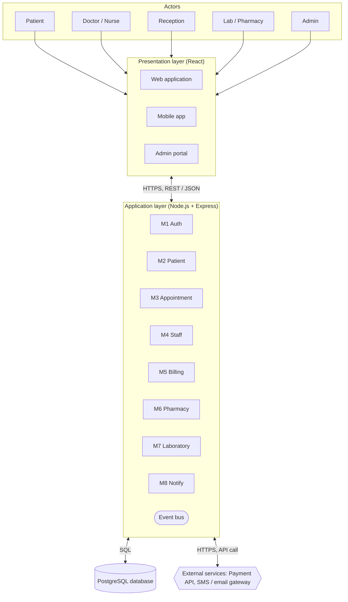

<div align="center">

# 🏥 Smart Hospital Management System (SHMS)

**A centralised, role-based platform that digitises patient care, appointments, billing, pharmacy, laboratory work and staff scheduling in one place.**


</div>

---

## 📑 Table of Contents

- [About the Project](#-about-the-project)
- [Problem Statement and Objectives](#-problem-statement-and-objectives)
- [Features](#-features)
- [User Roles](#-user-roles)
- [System Architecture](#-system-architecture)
- [Modules](#-modules)
- [Technology Stack](#-technology-stack)
- [Software Design](#-software-design)
- [Project Documentation](#-project-documentation)
- [Project Status and Roadmap](#-project-status-and-roadmap)
- [Getting Started](#-getting-started)
- [Repository Structure](#-repository-structure)
- [Team](#-team)

---

## 📌 About the Project

Hospitals handle large volumes of information and need constant coordination between doctors, nurses, patients, laboratories, pharmacies and administrators. When this is done manually or through disconnected tools, it leads to scheduling conflicts, duplicate entries, delays and human error.

The **Smart Hospital Management System (SHMS)** is a web-based platform that brings these activities into one secure portal. Every user sees only the screens and data that their role allows, and the system is organised into independent modules so that it can grow with the hospital.

> This repository contains the complete software-engineering work for SHMS: requirements, analysis, UML models, architecture, design patterns and design analysis.

---

## 🎯 Problem Statement and Objectives

**Problem.** Manual or disconnected hospital processes make it hard to find patient information, assign patients to the right doctor, coordinate appointments, and prepare doctor and nurse duty schedules. This causes delays, scheduling conflicts and a heavy administrative load.

**Objectives**

- Provide one centralised portal for patients, doctors, nurses, staff and administrators.
- Maintain organised patient records, prescriptions and medical reports.
- Simplify appointment booking, rescheduling and cancellation.
- Connect laboratory, pharmacy and billing with the clinical workflow.
- Protect sensitive medical data with authentication and role-based access control.
- Provide a modular, scalable foundation for future smart features.

---

## ✨ Features

### Core features (from the SRS and UML models)

| Area | What the system does |
|---|---|
| 🔐 Authentication | Secure login, role-based access control, automatic session timeout |
| 🧑‍⚕️ Patient management | Registration, unique patient ID, profile search, view and update |
| 📅 Appointments | View available slots, book, view and cancel; double-booking is prevented |
| 📋 Medical records | Diagnosis, history and allergies stored per patient |
| 💊 Prescriptions and pharmacy | Doctors prescribe; pharmacists manage medicines, stock and dispensing |
| 🧪 Laboratory | Doctors request tests; lab staff conduct tests and update results |
| 💳 Billing and payments | Bill generation, tax calculation, payment processing and receipts |
| 👥 Staff management | Doctor and staff profiles, departments, shifts |
| 📊 Reports | Hospital reports and statistics for administrators |
| 🔔 Notifications | Appointment reminders, lab-report-ready and low-stock alerts by SMS or email |

### Smart features (planned, from the feasibility study)

- Analysis of a doctor's report to **suggest a suitable doctor or department** for follow-up.
- **Automatic follow-up appointment** scheduling based on doctor availability.
- **Automatic weekly duty schedules** for doctors and nurses, including day and night shifts.

> These are intended as **decision support**, not a replacement for professional medical judgement.

---

## 👥 User Roles

Seven roles, all inheriting from a common `User` class (login, logout, update profile, change password).

| Role | Main use cases |
|---|---|
| **Patient** | Book, view and cancel appointments · view medical records · make payments |
| **Doctor** | Diagnose patients · generate prescriptions · request lab tests |
| **Nurse** | Manage and update patient profiles · assist in patient care |
| **Receptionist** | Register patients · schedule appointments · generate bills |
| **Laboratory staff** | Conduct lab tests · update lab results |
| **Pharmacist** | Manage medicines, stock and dispensing |
| **Admin** | Manage doctors and staff · generate hospital reports |

---

## 🏗 System Architecture

SHMS uses a **layered (n-tier) architecture built as a modular monolith**, with MVC in the presentation layer and an event-driven mechanism for notifications. It is one deployable application, but its code is split into eight modules with clear interfaces, so a module can later be extracted into a service if the hospital grows.




| Layer | Responsibility |
|---|---|
| **Presentation** | Screens, input collection, display of results. Contains no business rules |
| **Application** | Business rules and workflows (modules M1 to M8), event bus |
| **Data** | PostgreSQL database accessed only through repository classes |
| **External services** | Payment gateway (e.g. Razorpay) and SMS / email gateway |

---

## 🧩 Modules

| ID | Module | Responsibility | Depends on |
|---|---|---|---|
| **M1** | Authentication and Access Control | Login, JWT sessions, role permissions | — |
| **M2** | Patient Management | Registration, demographics, medical history | M1 |
| **M3** | Appointment Scheduling | Book, reschedule, cancel; check doctor availability | M1, M2, M4 |
| **M4** | Doctor and Staff Management | Staff profiles, specialisations, duty schedules | M1 |
| **M5** | Billing and Payment | Invoices for consultation, lab and pharmacy; payments and receipts | M2, M3, M6, M7 |
| **M6** | Pharmacy and Inventory | Prescriptions, dispensing, stock and low-stock levels | M1, M2 |
| **M7** | Laboratory and Diagnostics | Test orders, results, lab reports | M1, M2 |
| **M8** | Notification and Reporting | Reminders and alerts; admin analytics reports | M2, M3, M6, M7 |

---

## 🛠 Technology Stack

| Area | Technology |
|---|---|
| Frontend | React.js, HTML, CSS |
| Backend | Node.js with Express (REST APIs) |
| Database | PostgreSQL |
| Security | JWT authentication, bcrypt password hashing, role-based access control, HTTPS |
| Notifications | SMTP email, SMS gateway |
| Design and tools | StarUML, draw.io, Git and GitHub, Postman |

---

## 📐 Software Design

### Design approach

- **Strategy:** Hybrid. The system is decomposed top-down into modules, while shared services (authentication, database access, validation, notification sending) are built bottom-up.
- **Approach:** Object-oriented, using 16 classes.
- **Quality:** Low coupling (mostly data coupling through defined interfaces) and high cohesion (mostly functional or sequential cohesion).

### UML models

- **Class diagram:** 16 classes. `User` is the parent of `Patient`, `Doctor`, `Nurse`, `Admin`, `Receptionist`, `LaboratoryStaff` and `Pharmacist`. Data classes are `Appointment`, `MedicalRecord`, `Prescription`, `LabTest`, `Bill`, `Payment`, `Medicine` and `Report`. A `Bill` contains `Payment` as a composition.
- **Use case diagram:** 7 actors and 18 use cases, with `<<include>>` relationships: *Make Payment → Generate Bill*, *Diagnose Patient → View Medical Records* and *Request Lab Test → Conduct Lab Test*.
- **Sequence and activity diagrams:** patient registration, appointment booking, doctor consultation and prescription, and billing and payment.

### Design patterns used

| Pattern | Where it is used |
|---|---|
| **Layered architecture / MVC** | Separation of screens, controllers and models |
| **Repository** | Data access layer; services never write SQL directly |
| **Strategy** | Interchangeable payment methods and billing rules |
| **Observer / event-driven** | Appointment, lab and stock events published to M8 |
| **Factory** | Creation of notifications, reports and role objects |
| **State** | Appointment, bill and lab-test life cycles |
| **Facade** | One entry point for multi-step workflows such as booking |
| **Proxy** | Permission checks and audit logging for medical records |
| **Adapter** | Integration of external devices and third-party APIs |
| **Singleton (carefully scoped)** | Shared database pool, configuration and logging |

### Security principles

Protect patient privacy · role-based access with least privilege · encrypt data in transit and at rest · keep audit logs for access to medical records · design for backup and recovery · keep a human in the loop for safety-critical decisions.

---

## 📚 Project Documentation

All project documents are stored in the [`docs/`](docs) folder.

| Document | Description | File |
|---|---|---|
| Feasibility study | Problem statement, objectives, scope, technical and operational feasibility | [`docs/01-planning/feasibility-study.docx`](docs/01-planning/feasibility-study.docx) |
| Requirement elicitation | Stakeholders, interviews, personas, user stories, functional and non-functional requirements | [`docs/02-requirements/requirement-elicitation.docx`](docs/02-requirements/requirement-elicitation.docx) |
| Software Requirements Specification | IEEE-format SRS | [`docs/02-requirements/SRS.pdf`](docs/02-requirements/SRS.pdf) |
| Use case diagram | Actors, use cases and relationships | [`docs/03-analysis/use-case-diagram.pdf`](docs/03-analysis/use-case-diagram.pdf) |
| UML class diagram | 16 classes with attributes, methods and relationships | [`docs/04-design/class-diagram.pdf`](docs/04-design/class-diagram.pdf) |
| Sequence and activity diagrams | Four key workflows | [`docs/04-design/sequence-and-activity-diagrams.docx`](docs/04-design/sequence-and-activity-diagrams.docx) |
| Software Design Analysis Report | Modularisation, strategy, approach, coupling and cohesion | [`docs/04-design/software-design-analysis-report.pdf`](docs/04-design/software-design-analysis-report.pdf) |
| Architecture description | Architecture diagram, layers, services, patterns and principles | [`docs/05-architecture/architecture-description.pdf`](docs/05-architecture/architecture-description.pdf) |
| Software metrics report | Size, Halstead, function points and cyclomatic complexity (illustrative values) | [`docs/06-metrics/software-metrics-report.docx`](docs/06-metrics/software-metrics-report.docx) |

> ℹ️ The software metrics report uses **assumed** example values, because no source code existed when it was written. Replace them with measured values once the implementation is complete.

---

## 🗺 Project Status and Roadmap

**Current phase: design and documentation complete. Implementation not started in this repository.**

- [x] Problem statement, objectives and feasibility study
- [x] Requirement elicitation (stakeholders, personas, user stories)
- [x] Software Requirements Specification (SRS)
- [x] Use case, class, sequence and activity diagrams
- [x] Software architecture and design patterns
- [x] Software design analysis (modularisation, coupling, cohesion)
- [x] Software metrics calculation (illustrative)
- [ ] Database schema and migrations
- [ ] Backend REST APIs for modules M1 to M8
- [ ] React frontend (web, mobile, admin portal)
- [ ] Notification and payment gateway integration
- [ ] Automatic scheduling and report analysis (smart features)
- [ ] Testing (unit, integration, end-to-end)
- [ ] Deployment

---

## 🚀 Getting Started

> The application code has not been added yet. The steps below describe the intended setup for the chosen stack. **Update them to match the real scripts and environment variables when the implementation is added.**

**Prerequisites:** Node.js (LTS), npm, PostgreSQL, Git.

```bash
# 1. Clone the repository
git clone https://github.com/<your-username>/<your-repo-name>.git
cd <your-repo-name>

# 2. Backend
cd backend
npm install
cp .env.example .env        # add database URL, JWT secret, SMTP / SMS keys
npm run dev

# 3. Frontend (in a new terminal)
cd frontend
npm install
npm start
```

---

## 📁 Repository Structure

Suggested layout for the repository:

```
smart-hospital-management-system/
├── README.md
├── docs/
│   ├── images/
│   │   └── architecture-diagram.png
│   ├── 01-planning/          # feasibility study
│   ├── 02-requirements/      # elicitation report, SRS
│   ├── 03-analysis/          # use case diagram
│   ├── 04-design/            # class, sequence and activity diagrams, design analysis
│   ├── 05-architecture/      # architecture description
│   └── 06-metrics/           # software metrics report
├── models/
│   └── Smart_Hospital_Class_Diagram.mdj   # StarUML model
├── backend/                  # Node.js + Express (planned)
└── frontend/                 # React (planned)
```

---

## 👨‍💻 Team

Developed as a Software Engineering academic project at **KIET Deemed to be University**.

| Name | Roll number |
|---|---|
| Harsh Vardhan | 2400290120110 |
| Pallavi Tiwari | 2400290110199 |
| Jahnavi Pandey | 2400290120122 |
| Ishika Garg | 2400290120121 |
| Harshit Kumar Singh | 2400290120112 |

---

<div align="center">

⭐ If you find this project useful, consider giving the repository a star.

</div>